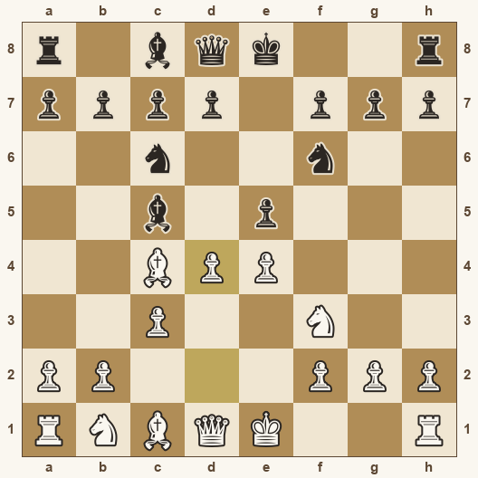
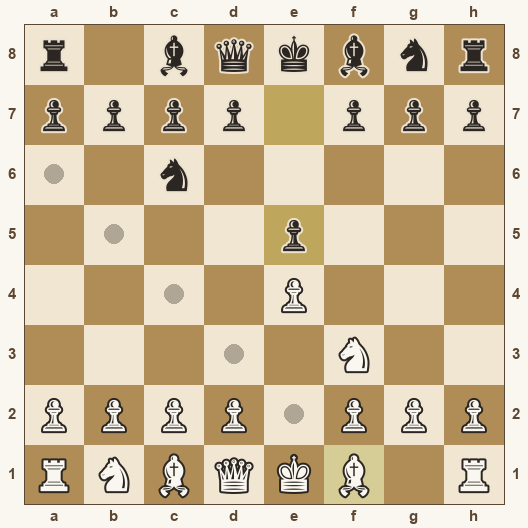
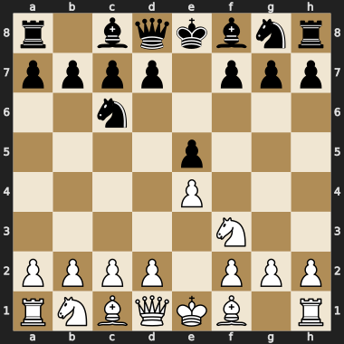
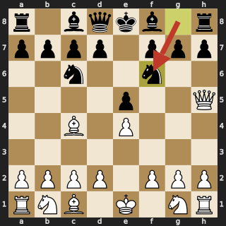
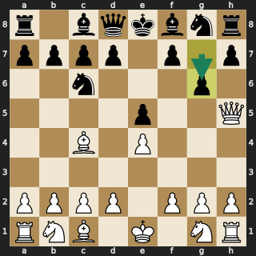

# Chess Tutor — an Explainable AI Coach

[](https://ai-chess-tutor-phnam05.streamlit.app/)

<p align="center">
  
</p>

A chess engine knows the best move, but it outputs a *number*, not an
explanation. A language model writes explanations that read well, but it gets
the chess wrong: it invents moves, miscounts pieces and makes up reasons, and
a learner can't tell. This MSc project (VinUniversity) builds and measures the
layer in between: a tutor that turns a strong engine's analysis into short,
level-adapted coaching **that is correct and names the reason that matters**.

## The core idea

**The engine decides the chess; the language model only explains it.**

- **Stockfish** determines the best move, evaluation, and predicted line —
  treated as ground truth.
- **Gemini** is given those facts and asked *only* to phrase them in natural
  language, adapted to the player's level. It never evaluates the position itself.

This separation is deliberate. Language models are unreliable at actually playing
chess — they hallucinate moves and miscount material. Grounding every explanation
in the engine's verified output keeps the tutor faithful to correct chess. The
model is a translator, not a player.

But the engine gives no *reasons*, and a model left to supply them makes them
up. So a third part, **board facts** (`board_facts.py`), computes in plain
Python, with no AI, what a human would notice about each move: "a pawn on c2
can chase it to c3", "it attacks the bishop on b5", "it allows checkmate on
f7". The model may give a move only the reasons those facts state.

## The research question

*When a language model explains a chess move from the engine's facts, is the
explanation **correct** (every claim true) and **relevant** (it names the
reason that matters)?*

- **The gap.** Letting the engine decide and the model phrase it is not new
  ([Kim et al., NAACL 2025](https://arxiv.org/abs/2410.20811)), and neither is
  checking each claim against the engine
  ([Hebbar et al., 2026](https://arxiv.org/abs/2608.04240)). Both find the
  engine cuts wrong facts, but the key idea is often still missing: in
  Hebbar et al.'s test the best set-up covers 60.9% of the experts' key points.
- **Results so far** (25 hand-picked test positions, so small):
  - invented moves: 0; answers fully faithful to the engine: 19/25 → 22/25
    (about 88%; 70–96% with this few cases) after two prompt fixes, checked
    against the author's hand audit (`faithfulness_eval.md`);
  - asking for "plainer language" made it *less* faithful (16/25 vs 22/25):
    plain explanations invite an invented "because…";
  - a hand check of how the coach walks through a line: 9 of 13 answers
    still had a problem, mostly that it never says *why the better move is
    better* (`walkthrough_audit.md`). That's the relevance gap.
- **Next:** fresh test positions with a human answer key, and a comparison
  with simpler ways of explaining (the model alone; the model with the raw
  engine output; fixed sentences with no model).

## Ways to use it

One screen: a click-to-move board you play on — for **both sides**, or one
side against a weak **Stockfish bot** (strength 0–20) — with the coach watching
every move, plus a **Show best move** button that reads whatever position is on
the board. Under every explanation, a closed box, **Prompt sent to Gemini**,
shows the exact text the coach sent (the model, the level, the instructions and
the engine and board facts), for research and debugging.

**Play a move.** Click a piece (its legal moves dot the board) and move it. The
coach grades it instantly: a quality label (*Best* → *Blunder*), the win-chance
swing, and the engine's preferred move when you missed it. For a weak move the
coaching leads with *why* it fails — walking the engine's **refutation**, the
punishing reply you overlooked — before naming the better move. That turns a
mistake into a targeted lesson rather than mere analysis.

<p align="center">
  
</p>

<p align="center"><em>Legal moves dot the board; the last move stays tinted. The coach grades every move, for both sides.</em></p>

**Show best move.** Ask the engine for the strongest move and its evaluation in
the current position, then have the coach put the reasoning into words — a hint
on demand, not a running spoiler.

<p align="center">
  
</p>

<p align="center"><em><strong>Show best move</strong> — here the engine's pick is <strong>Bb5</strong> (eval <strong>+0.32</strong>), which the coach explains at your chosen level.</em></p>

**The before/after comparison.** When a move is graded, two boards show your move
(arrowed in the verdict's colour) and the engine's best (green) side by side — so
the difference is visible, not just described.

<table align="center"><tr>
  <td align="center"><br><em>You played <strong>…Nf6</strong></em></td>
  <td align="center"><br><em>Engine's best, <strong>…g6</strong></em></td>
</tr></table>

<p align="center"><em>The natural <strong>…Nf6</strong> even attacks the queen, yet it's a <strong>Blunder</strong>: it allows Scholar's mate (Qxf7#), and the win chance falls from <strong>54% to 3%</strong>.</em></p>

**Set up any position.** The live board is shown beneath as a copyable FEN; edit
it and press *Load* to jump there and study a specific spot.

## How it works

```
Position (FEN)  [+ a played move, when you make one]
      │
      ▼
python-chess ──► Stockfish        →  best move, evaluation, the line it
   (rules,         (analysis)          expects; for a played move, its grade
    board)                              and refutation
      │
      ▼
Board facts (plain code)          →  what a human would notice about each
      │                                move in those lines
      ▼
Explanation layer (Gemini)        →  the facts in words, level-adapted
      │                                (beginner / intermediate / advanced)
      ▼
Streamlit UI                      →  board + engine verdict + coaching
                                       + the exact prompt sent to Gemini
```

For a played move the engine also gives its line *after* that move — the
refutation — so a weak move's punishment can be explained. The facts go into
a prompt whose system instruction forbids suggesting a different move,
inventing evaluations, or giving a move a reason its facts don't state. A
separate checker (`faithfulness.py`) flags any move or reason in the answer
that the engine never gave; it is a research tool, not part of the app.

## Level adaptation

Same engine and board facts, explained differently, and only as far as there
is a reason to give (the line is cut at 2 / 3 / 4 half-moves; hand-picked):

- **Beginner** — 3–4 short sentences, pieces named in words ("your knight"),
  each idea a simple visible thing (a piece is attacked, can be chased, the
  king gets safe); no jargon.
- **Intermediate** — each move's idea, then the move; standard terms
  (development, tempo) only as names for what a fact already says.
- **Advanced** — every move of the line in notation with its fact, and a
  precise evaluation; never a guess at why the evaluation is what it is.

## Tech stack

- **Python** + **Streamlit** (web interface)
- **Stockfish** — chess engine (off-the-shelf; not this project's contribution)
- **python-chess** — board, rules, FEN/PGN, engine communication, SVG rendering
- **Pillow** + **streamlit-image-coordinates** — render the clickable board to a
  PNG (no system libraries, so it's identical locally and on the Cloud) and turn a
  click into a square
- **Google Gemini** (`google-genai` SDK) — the explanation layer

## Running it locally

Requires Python 3.10+ and a free Google AI Studio API key.

```bash
# 1. Clone, then create a virtual environment
git clone https://github.com/phnam05/AI-chess-tutor.git
cd AI-chess-tutor
python -m venv venv
venv\Scripts\activate          # Windows  (source venv/bin/activate on macOS/Linux)

# 2. Install dependencies
pip install -r requirements.txt

# 3. Add the Stockfish engine — download from stockfishchess.org/download
#    and place it here as stockfish.exe (Windows)

# 4. Add your Gemini key at .streamlit/secrets.toml:
#    GOOGLE_API_KEY = "your_key_here"

# 5. Run
streamlit run app.py
```

On Streamlit Community Cloud, add the same `GOOGLE_API_KEY` line via the app's
**Settings → Secrets** panel instead of committing it.

## Project structure

```
engine_analysis.py    # Stage 1: queries Stockfish → facts (the backbone)
move_review.py        # grades a played move against the engine's best
explainer.py          # Stage 2: grounded, level-adapted explanation layer
board_facts.py        # what a human would notice about each move (no AI)
engine_pool.py        # one shared, persistent Stockfish process + engine discovery
board_ui.py           # renders the clickable board + maps click → square
app.py                # Streamlit interface (analyze + play)
scripts/make_readme_images.py   # regenerates images/ from the app's own renderers

# Research scripts (run by hand)
faithfulness.py           # the checker: flags moves/reasons the engine never gave
evaluate_faithfulness.py  # runs the 25 test cases through the whole chain
validate_checker.py       # scores the checker against the author's hand audit
build_audit.py            # builds the hand-audit sheet
walkthrough_eval/         # measurements of the line walk-through
```

README images are produced by `python scripts/make_readme_images.py` using the
app's actual rendering code, so they stay honest to what the UI shows.

## Limitations

- Explanation polish depends on the language model; the architecture constrains
  *what* it can claim, not how well every sentence reads.
- The checker sees invented moves and invented reasons for the evaluation, not
  an invented *idea* written in words ("the threat to your knight"), so human
  checks are still needed. The results above come from only 25 cases, used
  while building the fixes.
- Board facts can't name pins, forks or skewers, pawn structure or plans; for
  those the coach has no reason to give.
- The engine searches to a fixed depth (15) — strong, but not exhaustive. A
  fixed depth, not a time limit, keeps it repeatable: the same position always
  gets the same answer.
- Coaching is still per-move: no conversation across the game, no memory between
  sessions (see below).

## Future directions

- **Explanations that fit the player** (a later study): guess a player's level
  from their moves and adapt to it.
- **Conversational dialogue.** Let the student ask "why?" or "what if?" across
  the whole game.
- **Beyond board games.** Ground an explanation in an authoritative source, then
  adapt it to the learner, in problems with no clean evaluation function (e.g.
  coaching a physical skill from video).

## Why this project

A demonstration of explainable AI for complex decision-making: an AI that improves
human skill rather than replacing it. Chess was chosen for its clean, verifiable
engine and because the author knows it well enough to judge whether the
explanations are genuinely good — letting the work focus on the explanation and
adaptation layer, the transferable, research-relevant contribution.
